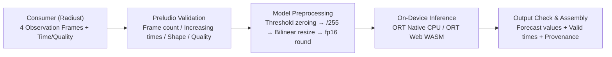

<h1 align="center">Preludio</h1>

<p align="center">
  <a href="README.md">简体中文</a> · <a href="README.en.md">English</a>
</p>

**On-device radar nowcasting.** Forecast the rain before it begins, on your device.

## Project Purpose & Scope

Preludio is an on-device weather radar nowcasting runtime. It takes a sequence of recent radar observations, runs model-specific preprocessing and inference locally on the user's device (native desktop or browser), and returns forecast fields with valid times, grid descriptors, and provenance metadata.

- Once the model package and observation frames are on the device, the inference pipeline runs locally offline and does not fall back to cloud inference.
- Responsibilities across the stack:
  - Upstream Training (e.g., PyTorch training pipelines): Model architecture, training, checkpoints, and meteorological evaluation.
  - Preludio (this repository): Versioned model package verification, input contract validation, model preprocessing, local execution (ONNX Runtime Native / Web WASM), and forecast assembly.
  - Radiust / Consumers: Radar data ingestion, scientific decoding, map projection, general regridding, and timeline UI ([Radiust](https://github.com/chorust/radiust) is the first target consumer).



## Features

### 1. Cross-Platform Local Runtime (Shared Core)
- Native Rust Runtime (`preludio` crate): Local CPU inference via ONNX Runtime Native (`ort`), with no `unsafe` code and thread-safe sessions (`Send + Sync`).
- Web Browser Runtime (`@chorust/preludio`): Reuses the Rust validation, preprocessing, and forecast assembly core via `wasm-bindgen`, paired with `onnxruntime-web` running multi-threaded WASM inference in a Web Worker off the main thread.
- Developer CLI (`preludio replay`): Replays predictions from 8-bit grayscale PNG frames or `.npy` tensors, compares against PyTorch/ORT reference outputs, and writes `ValidationRecord` and `MeasurementRecord` files.

### 2. Versioned Model Packages & Target Policies
- Model Package Contract (`preludio.model-package/1`): Validates `manifest.json` against the schema and checks the SHA-256 hash of `model.onnx` on load, rejecting corrupted or incompatible artifacts.
- Target Policy (`TargetPolicy`):
  - `SupportedOnly` (default): Requires the platform, engine version, execution provider, thread count, and Web cross-origin isolation setting to match a registered target, then marks outputs with `verified = true`. The manifest references validation and measurement records; the runtime does not read or validate those record files.
  - `Validation`: Allows running benchmarks and verification on unrecorded configurations, marking outputs with `verified = false`.

### 3. Input Validation & Model Preprocessing
- Four-Frame `raw-u8` Contract: Accepts 4 single-channel `u8` grayscale frames (`[0, 255]`, matching duckomo gray semantics) with common positive `[H, W]` dimensions and strictly increasing timestamps (intervals may vary; Web predictions reject floating-point observation buffers before preprocessing).
- Per-Pixel Quality Masks: Distinguishes valid pixels (`Valid = 0`, where `0` represents no-echo) from invalid masks (`Missing = 1` and `OutsideCoverage = 2`, rejected under the current policy).
- Preprocessing Pipeline: Optional sequence-level threshold zeroing (pixels strictly `< zero_threshold` become `0`; omitting or `0` leaves values unchanged) → `/255` normalization → anti-aliased bilinear resize (`align_corners = false`) to the model tensor shape (`448×448`) → `float16` rounding back to `float32`.

### 4. Dynamic Lead Times & Provenance
- Output Tensor Shape Verification: Checks every dimension of the actual output tensor against the manifest declaration (`[1, 20, 448, 448]`) before assembling forecasts.
- Dynamic Valid Times (`valid_times`): Uses the average input interval `(last_time - first_time) / 3` and rounds $k \times \text{average\_interval}$ independently to the nearest second (half-seconds rounded up) for each output index $k \in [1, N]$, keeping weather valid times (`valid_times`) separate from computation time (`generated_at`).
- Provenance (`provenance`): Records input frame IDs and timestamps, last observation time, model and checkpoint hashes, and the actual execution engine, provider, and thread count. No physical-value conversion (e.g., dBZ) or spatial projection is performed (`georeferenced = false`).

## Current Support & Historical Browser Measurements

The fixed reference for `GhostUNet3D` (`step_22000`, input `[1, 4, 448, 448]`, output `[1, 20, 448, 448]`) compares 4,014,080 values under `rtol=1e-4, atol=1e-5`:

| Target ID | Platform & Backend | Threads | Warm Inference | Peak Memory | Memory Budget | Status |
| --- | --- | ---: | ---: | ---: | ---: | --- |
| `macos-arm64-ort-cpu` | macOS arm64 (Apple M4 Pro, ORT CPU) | 4 | ~1.40 s | 1700.9 MiB RSS | ≤ 1740.8 MiB | Verified |

The current model package no longer declares Chrome as a supported target. The [browser validation history](docs/roadmap.md#7-m4web-wasm-运行时与浏览器验证) summarizes the earlier fixed-reference results: zero numerical failures and 1725.04 MiB peak memory; the recorded `pass = true` reflected only the numerical and memory budgets. The original JSON records are local model artifacts and are not distributed with the repository. A later headless Chromium four-thread acceptance run took 21.15–28.60 s warm and had a 1064.54 ms maximum rAF gap, missing the ≤ 8 s inference and < 100 ms rAF budgets. Chrome is therefore not currently in the supported list, and full browser acceptance has not passed.

WebAssembly multi-threading still requires cross-origin isolation on the hosting page:
- `Cross-Origin-Opener-Policy: same-origin`
- `Cross-Origin-Embedder-Policy: require-corp`

The Web `supported` policy requires an exact match for platform, engine, version, provider, and actual thread count. Chrome can currently be exercised locally with `validation` policy, but the execution is unverified. Safari is unsupported.

## Usage

### 1. Native Rust

Open and verify the `ModelPackage` once at startup, then share the `Session` across predictions (e.g., via `Arc<Session>`). `Session::predict` is synchronous and blocking; run it on a blocking worker thread (`tokio::task::spawn_blocking`) when integrating with an async runtime.

```rust
use preludio::{
    Forecast, FrameValues, GridDescriptor, ModelPackage, ObservationFrame,
    ObservationSequence, PixelQuality, PreludioError, Session, SessionOptions,
    TargetPolicy,
};

fn open_session() -> Result<Session, PreludioError> {
    let package = ModelPackage::open("artifacts/ghost-unet3d-step-22000")?;
    Session::open(
        package,
        SessionOptions {
            policy: TargetPolicy::SupportedOnly,
            threads: None, // Uses the target's declared thread count (4)
        },
    )
}

fn run_forecast(session: &Session, frames: Vec<ObservationFrame>, shape: [usize; 2]) -> Result<Forecast, PreludioError> {
    let sequence = ObservationSequence {
        grid: GridDescriptor {
            id: "radar-grid".to_owned(),
            shape,
            georeference: None,
        },
        encoding: "training-grayscale-u8".to_owned(),
        frames, // Exactly 4 frames, ordered oldest to newest with strictly increasing valid_time
        zero_threshold: None, // Optional: Some(t) zeros pixels strictly < t before /255 and resize
    };
    session.predict(&sequence)
}
```

### 2. Web / TypeScript (`@chorust/preludio`)

`packageUrl` serves `manifest.json` and the model file declared in the manifest. Session creation accepts an `AbortSignal` and releases the created engine before rejecting if aborted during initialization.
The current model manifest declares only the native macOS target. This browser example uses `validation` for local evaluation, so the execution is unverified; the default `supported` policy rejects browser configurations without a matching registration.

```ts
import {
  createSession,
  type Forecast,
  type NowcastSession,
  type ObservationSequence,
} from "@chorust/preludio";

async function runWebNowcast(observations: ObservationSequence): Promise<Forecast> {
  const session: NowcastSession = await createSession({
    packageUrl: "/models/ghost-unet3d-step-22000",
    ortWasmPaths: "/ort/",
    policy: "validation",
  });

  try {
    session.onStateChange((state) => {
      console.log("Nowcast state:", state); // "idle" | "running" | "succeeded" | "failed"
    });
    return await session.predict(observations);
  } finally {
    await session.dispose();
  }
}
```

### 3. CLI Replay, Validation & Benchmarking

Build with the `cli` feature to run `preludio replay` on four 8-bit grayscale PNGs or `.npy` tensors, verify numerical parity, and record target measurements:

Without `--record`, `--runs` defaults to one inference; with `--record`, it defaults to six total calls (one cold plus five warm). An explicit count overrides either default; recording fewer than six is rejected with exit code 2 before the package is opened. Raw `--frames` with an explicit `--reference` triggers shape checks and bit-for-bit comparison with the package's `reference/input.npy` when present; a mismatch exits with code 5, whether or not recording is enabled.

The example below requires a local model package containing `reference/input.npy` and `reference/reference.npy` (see [GhostUNet3D export instructions](docs/ghost-unet3d.md#export-and-verify)). It replays the preprocessed tensor directly. The four original PNG frames are not distributed with the repository; to use `--frames`, obtain the original grayscale PNGs for the corresponding timestamps and pass their actual paths.

```sh
# 1. Run unit and contract tests
cargo test

# 2. Replay the package's preprocessed tensor and verify against the reference forecast
export PKG="artifacts/ghost-unet3d-step-22000"
export TIMES="2023-11-30T09:24:00Z,2023-11-30T09:30:00Z,2023-11-30T09:36:00Z,2023-11-30T09:42:00Z"

cargo run --release --features cli -- replay \
  --package "$PKG" \
  --tensor "$PKG/reference/input.npy" \
  --times "$TIMES" \
  --reference "$PKG/reference/reference.npy"

# 3. Build and test the Web package & smoke server
cd web && bun install && bun run build && bun test
bun run smoke
```

## Roadmap

Milestones and exit criteria are tracked in [docs/roadmap.md](docs/roadmap.md):

| Milestone | Goal | Status | Notes & Next Steps |
| --- | --- | --- | --- |
| M0 | Model Deployment Spike | Completed | Exported `GhostUNet3D` PyTorch checkpoint (`step_22000.ckpt`) to ONNX opset 18, resolved GroupNorm export precision, and verified CPU numerical parity against PyTorch (max abs error `9.61e-7`). |
| M1 | Runtime Input Contract & Source Compatibility | In Progress | The four-frame `raw-u8` contract, arbitrary positive `[H, W]` resize, `zero_threshold`, and dynamic lead calculation are implemented in Rust/Web and have passed fixed-reference parity checks. Remaining: confirm a concrete Radiust source that supplies duckomo-compatible `raw-u8` bytes. |
| M2 | Native Runtime & macOS Verification | Completed | Standalone Rust runtime runs without a Python training environment; `macos-arm64-ort-cpu` passed reference parity and device budget on Apple M4 Pro (~1.40 s warm inference, 1700.9 MiB RSS). |
| M3 | First End-to-End Radiust Integration | Pending | Depends on M1 source confirmation; connect a real Radiust source through local inference to timeline display with observation/forecast boundaries (US5). |
| M4 | Web WASM Runtime & Browser Verification | Partially Complete | `@chorust/preludio` build (including TypeScript `.d.ts` declarations), fixed-tensor reference, and real-model browser threshold-equivalence checks passed. Chrome is not registered as supported; the headless Chromium four-thread run used 1725.06 MiB but took 21.15–28.60 s warm with a 1064.54 ms max rAF gap, missing performance and responsiveness budgets. Standard four-thread browser and 10-run offline acceptance remain incomplete. |
| M5 | Meteorological Evaluation & Mobile/Edge | Planned | Build an independent weather-event evaluation dataset with per-lead baselines; evaluate Core ML / WebGPU operator compatibility and iOS / Android / Watch targets when device budgets are defined. |

## Documentation

| Document | Contents |
| --- | --- |
| [Quickstart](specs/001-local-nowcast-runtime/quickstart.md) | Build, replay, invalid-input checks, offline verification, and device measurement commands |
| [Rust API Contract](specs/001-local-nowcast-runtime/contracts/rust-api.md) | `preludio` crate signatures, error types, and CLI specification |
| [Web API Contract](specs/001-local-nowcast-runtime/contracts/web-api.md) | `@chorust/preludio` TypeScript types, session lifecycle, and cross-origin isolation rules |
| [Radiust Integration](docs/radiust-integration.md) | Consumer `RadarField` mapping, quality mask conversion, and native/Web call patterns |
| [Project Spec](docs/spec.md) | Product scope, data contract, requirements, and acceptance criteria |
| [Architecture](docs/architecture.md) | Module boundaries, model package layout, preprocessing pipeline, and design decisions |
| [Roadmap](docs/roadmap.md) | Milestones, dependencies, recorded measurements, and exit criteria |
| [GhostUNet3D Spike](docs/ghost-unet3d.md) | Model reproduction, GroupNorm numerical validation, and backend limits |

## License

Apache-2.0
