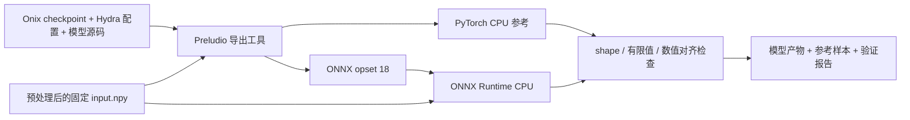
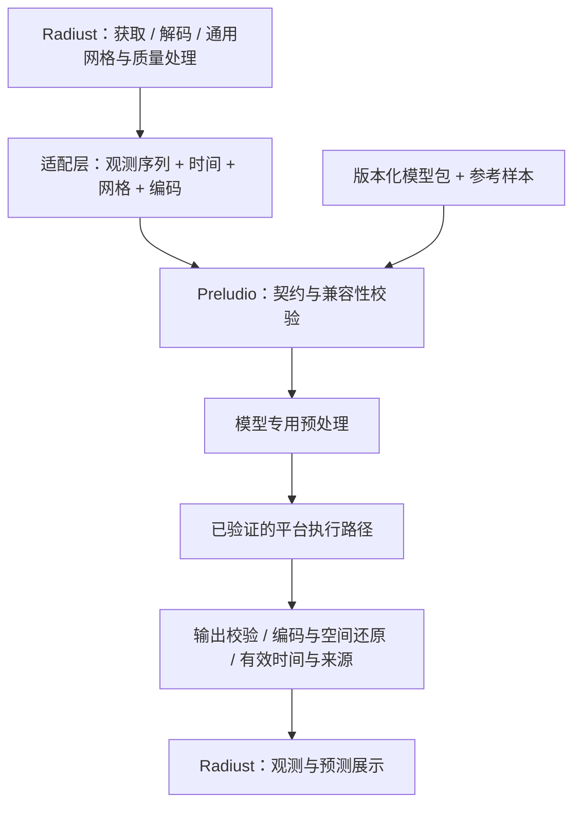

# Preludio Architecture

更新日期：2026-10-24。本文分别描述已有部署工具与目标运行时。产品要求见 [Spec](spec.md)，交付顺序见 [Roadmap](roadmap.md)。

## 1. 架构边界

Preludio 的工作方案是一个独立、可复用的端侧预测组件，Radiust 是首个消费者。共享的重点是观测与预测的语义、模型契约和参考样本；执行引擎按模型与设备证据选择。

| 边界 | 职责 |
| --- | --- |
| Onix 训练侧 | 网络定义、训练、checkpoint、训练配置、训练数据编码说明与模型效果评估 |
| Preludio 开发工具 | 导出模型、记录身份与契约、产生参考结果、验证部署数值与性能 |
| Radiust / 其他消费者 | 数据发现、获取、科学解码、质量信息、地理坐标、通用重网格、缓存、UI 与时间轴 |
| Preludio 目标运行时 | 校验输入与模型兼容性、模型专用预处理、加载与执行模型、输出校验与已验证的还原、预测来源元数据 |
| 平台执行适配 | 将已准备 tensor 送入指定引擎，返回 tensor 与实际执行信息；管理平台会话和资源 |

通用重网格属于数据侧，训练约定的归一化、448² resize 和张量排列属于模型侧。适配层必须记录二者的关系，避免重复缩放或把空间还原当成一次无条件 resize。训练期的增强也不自动成为推理步骤。

## 2. 当前实现

目前没有生产运行时；Rust crate 只提供 `VERSION`。已实现的是 Python 导出与 CPU 数值验证链路：



| 现有文件 | 作用 |
| --- | --- |
| [src/lib.rs](../src/lib.rs) | 占位 Rust API，无模型加载或预测能力 |
| [tools/export_ghost_unet3d.py](../tools/export_ghost_unet3d.py) | 重建网络、严格加载权重、导出 ONNX、运行 CPU 比较、写入 manifest 与报告 |
| [tools/test_export_ghost_unet3d.py](../tools/test_export_ghost_unet3d.py) | 权重前缀、输入校验、合成输入复现及 GroupNorm 精度回归测试 |
| [tools/requirements-export.txt](../tools/requirements-export.txt) | 导出工具的 Python 依赖 |
| [GhostUNet3D spike](ghost-unet3d.md) | 模型契约、真实输入复现、环境与误差记录 |

原始 PNG 的预处理目前按 spike 文档单独执行；导出脚本接收已处理的 `.npy`，不读取时间、地理网格或质量元数据。它不能代替实时观测输入校验。

导出时直接读取 Onix 模型源码，移除 Lightning / `torch.compile` 的 `net._orig_mod.` 权重前缀，并严格加载参数。加载 checkpoint 涉及 Python pickle，只用于可信开发产物；消费端目标是加载已导出的推理模型，不携带训练环境。

产物写入被忽略的 `artifacts/ghost-unet3d-step-22000/`，没有作为发布模型提交。该目录中的 `manifest.json`、`validation.json`、`input.npy`、`reference.npy`、`forecast.npy` 和 `model.onnx` 组成当前实验记录；原始 PNG 来源记录另在本地 `artifacts/ghost-unet3d-input/provenance.json`。迁移或发布参考样本时要一并保存这些来源信息。

## 3. 目标数据流

下图是待实现的逻辑边界，不是已有包或进程划分。



一次预测应沿以下顺序执行：

1. 加载模型包，检查契约版本、模型哈希及所请求后端的支持状态。
2. 从适配层接收观测和元数据，检查帧数、时间、网格、编码、质量及数值有效性。
3. 按该模型的版本化规则完成预处理；只执行已声明且经过验证的转换。
4. 在设备上运行模型，校验输出 shape、有限值与编码约束，并保留实际后端信息。
5. 按已确认的映射解释输出及空间位置，计算预测有效时间，附加来源信息后交还消费者。

当前模型尚未确认物理和地理映射，第 5 步只能保留训练灰度语义；张量级结果不能直接作为地理定量预测交付。

## 4. 契约与模型包

### 4.1 三类概念

以下是逻辑对象，不固定 Rust 或 TypeScript 类型名。

| 对象 | 内容与不变量 |
| --- | --- |
| 观测序列 | 每帧的数值、编码或单位、有效时间、质量、来源与网格；进入模型前证明各帧兼容 |
| 模型包 | 精确产物身份、tensor 定义、预处理、输出解释、时间与网格条件、验证过的后端及参考样本 |
| 预测结果 | 预测值与编码、输出网格、各帧有效时间、输入标识、模型身份、生成时间与实际执行后端；明确标为预测 |

Preludio 公共契约不直接依赖 Radiust 的 `RadarField`。首个适配器应核对 Radiust 当时的实现再转换；原讨论引用的类型只提供设计背景，不是固定 ABI。

`valid_time` 表示该帧对应的天气时刻，`generated_at` 表示计算完成时间，二者不可替代。对当前样本，最后观测 `09:42Z` 对应预测 `09:48Z` 至 `11:42Z`，与任务何时运行无关。

### 4.2 当前 manifest 与下一步差距

当前导出 manifest 已记录模型与 checkpoint 哈希、配置和源码哈希、tensor shape / 轴顺序 / 值域、六分钟间隔、输出时效、预处理方式及已验证 CPU provider。`physical_dbz_mapping` 和 `georeferencing` 明确为 `null`。

它仍是实验格式，尚无稳定 schema 版本，也未完整描述缺测、质量、原始观测时间与网格、输入来源哈希和公共结果结构。不能直接把此格式视为已发布运行时协议。

M1 应以现有 manifest 为起点补齐这些必要语义，保留输入、参考输出及来源，并约定契约版本与不兼容行为。模型标识用于阅读，内容哈希用于锁定产物；`last.ckpt` 或仅有 step 编号不足以区分后续训练与导出变化。

### 4.3 初始模型的精确路径

```text
4 × 灰度 PNG，时间从旧到新
  → uint8 转 float32，除以 255
  → bilinear resize 至 448 × 448，antialias=true，align_corners=false
  → float16 舍入后转回 float32；本次无旋转
  → [1, 4, 448, 448]
  → GhostUNet3D / ONNX CPU
  → [1, 20, 448, 448]，归一化训练灰度，配置时效 +6 至 +120 分钟
```

外部 tensor 为四维，网络内部使用真实时间轴和 3D 卷积。跨语言复现必须包含插值细节和 float16 舍入；仅做 `/255` 或使用不同 resize 不能视为相同输入。

## 5. 后端与代码组织

| 路径 | 当前证据 | 下一步 |
| --- | --- | --- |
| Python + ONNX Runtime CPU | Linux ARM64 上已对齐，是部署参考 | 保留导出工具和固定参考，不作为消费端训练依赖 |
| Rust + ONNX Runtime Native | 工作候选，crate 尚未接入引擎 | 选绑定并验证 CPU；在目标 macOS 测量 |
| macOS Core ML | 未转换、未测量 | 明确是 ORT provider 还是独立转换路径，再验证算子、误差与收益 |
| TypeScript + ONNX Runtime Web / WASM | 未运行 | 用固定输入验证兼容性与资源开销 |
| WebGPU | 当前模型含 Conv3D，官方支持表有明确限制 | 兼容模型或独立算子转换实验，不承诺直接运行 |
| iOS / Android / Watch | 仅长期方向 | 需求与资源预算明确后单独设计 |

截至 2026-10-24，ONNX Runtime Web 的[官方 WebGPU 算子表](https://github.com/microsoft/onnxruntime/blob/main/js/web/docs/webgpu-operators.md)标注 Conv3D 不受支持。CPU 导出成功无法证明 WebGPU 可用；也没有证据表明 WASM 能满足当前模型的速度和内存需求。

先在现有 crate 和 `tools/` 内完成必要工作。出现真实 Web 需求时再增加 TypeScript 入口；只有重复逻辑和构建边界已经清楚，才考虑共享 Rust / WASM 核心、FFI 或独立 contract 包。原讨论的多 crate、多 App 目录树是远期草图。

执行适配只需承接“准备好的输入 → 预测 tensor 与执行信息”的边界；第二个后端出现前，不先建通用插件框架。无论语言或引擎如何变化，都用同一组参考样本验证语义和数值。

桌面 UI 留在 Radiust。Tauri + TypeScript 是候选，是否维护原生与 Web 两条执行路径由设备测量决定。网页的数据获取与权限同样由消费者处理，不通过把整个数据引擎编译到 WASM 来假设问题已解决。

## 6. 失败行为与验证

目标运行时应区分模型包或后端不可用、输入不兼容、执行失败与输出无效。具体错误类型待公共 API 确定；失败应保留可诊断上下文，不返回伪造的正常预测。缺帧不自动补零，未知单位不自动归一化，缺少空间映射不生成猜测坐标。

可以使用另一个已验证的本地后端，但必须让调用方知道实际执行路径和失败原因。不设计自动云端推理回退；也不把新观测到达前的旧结果标记成新预测。

验证按四个层次建立证据：

| 层次 | 比较内容 | 当前状态 |
| --- | --- | --- |
| 输入契约 | 原始观测到模型 tensor，含时间、网格、编码、质量与舍入 | PNG 数值路径已复现；物理与空间语义未确认 |
| 数值部署 | 同一 tensor 的 PyTorch 与目标后端输出 | 一个真实窗口通过 ONNX CPU；其他后端未验证 |
| 设备运行 | 冷热延迟、内存、连续运行、实际 provider 和应用集成 | 只有一次 Linux CPU 测量 |
| 气象效果 | 独立天气过程、逐时效指标、对照基线 | 尚未评估 |

当前最大绝对误差为 `9.61125e-7`，通过 `rtol=1e-4, atol=1e-5` 检查。GroupNorm 默认导出在本机出现较大误差，最终用居中方差与逐轴归约的标准 ONNX 算子保持精度；网络和权重不变。变更预处理、导出路径、精度或引擎后需重新验证，不能把这一窗口的结果推广到其他组合。

## 7. 决策记录

| 编号 | 结论 | 状态与依据 | 重新评估的条件 |
| --- | --- | --- | --- |
| D-01 | 定位为用户设备本地雷达预测，Radiust 为首个消费者 | 已确认方向；来自[原讨论](https://chatgpt.com/share/6adc388e-0c64-83e8-88bc-8c72823f9a31) | 产品目标改变 |
| D-02 | 使用训练中的 step 22000 建立部署参考 | 用户授权，spike 已完成；实际文件名为 `step_22000.ckpt` | 新 checkpoint、发布候选或数据契约变化 |
| D-03 | ONNX opset 18 float32 + CPU 作为当前数值基线 | 已实测；固定尺寸，模型 29.63 MiB | 新模型、设备或优化要求出现 |
| D-04 | GroupNorm 用逐轴归约导出，保留严格数值检查 | spike 已实施；默认导出未通过容差，详见[实验记录](ghost-unet3d.md#normalization-export) | 引擎或导出器升级后重新比较 |
| D-05 | 数据获取与通用网格归 Radiust，模型转换与推理归 Preludio；通过独立契约适配 | 工作方案；避免把消费者类型固定为公共接口 | 实际接入揭示职责重叠或无法表达的数据语义 |
| D-06 | 先完成一个经验证的本地路径，再决定更多后端与共享模块 | 当前推进方案；多平台仍无设备证据 | 第二条路径通过兼容性和性能实验 |
| D-07 | Core ML、Tauri、WebGPU、移动端 SDK 不提前确认为依赖 | 待决策；当前 GhostUNet3D 的 WebGPU Conv3D 存在限制 | 对应模型与目标设备验证完成 |

此前“Web 优先”与“桌面优先”的建议在这里收敛为先验证模型、数据和设备，再确定交付顺序。当前不复制早期 API 草图、平台支持表或示例时效作为已实现承诺。
