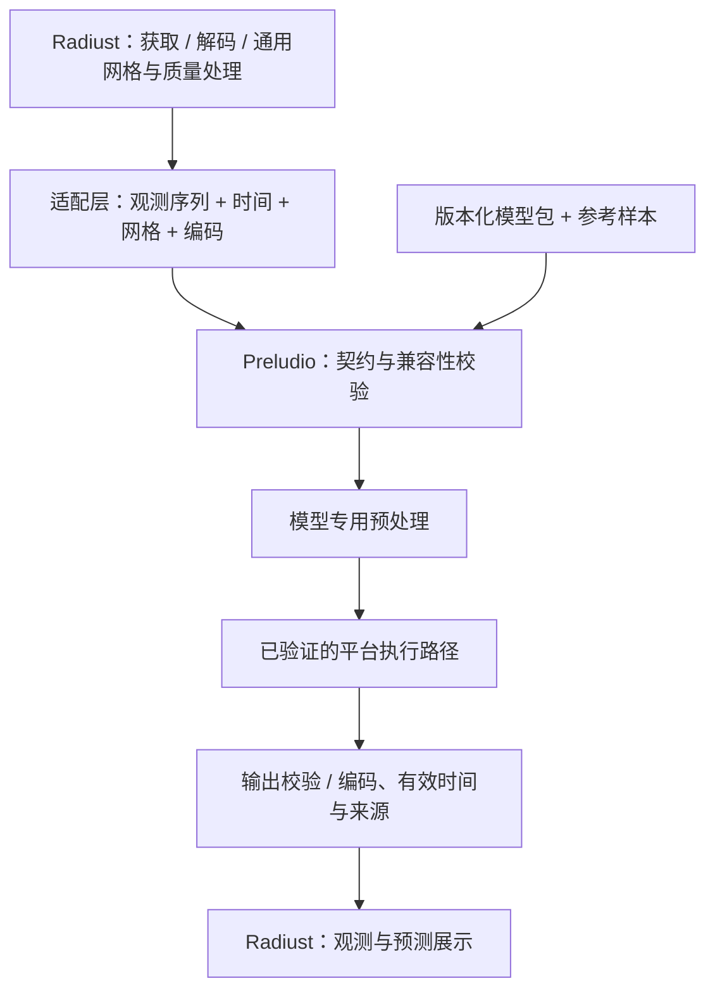

# Preludio Architecture

更新日期：2026-10-24。本文分别描述已有部署工具与目标运行时。产品要求见 [Spec](spec.md)，交付顺序见 [Roadmap](roadmap.md)。

## 1. 架构边界

Preludio 的工作方案是一个独立、可复用的端侧预测组件，Radiust 是首个消费者。共享的重点是观测与预测的语义、模型契约和参考样本；执行引擎按模型与设备证据选择。

| 边界 | 职责 |
| --- | --- |
| Onix 训练侧 | 网络定义、训练、checkpoint、训练配置、训练数据编码说明与模型效果评估 |
| Preludio 开发工具 | 导出模型、记录身份与契约、产生参考结果、验证部署数值与性能 |
| Radiust / 其他消费者 | 数据发现、获取、科学解码、质量信息、地理坐标、通用重网格、缓存、UI 与时间轴 |
| Preludio 目标运行时 | 校验输入与模型兼容性、模型专用预处理、加载与执行模型、输出校验与已验证的还原、预测来源元数据 |
| 平台执行适配 | 将已准备 tensor 送入指定引擎，返回 tensor 与实际执行信息；管理平台会话和资源 |

通用重网格属于数据侧，训练约定的归一化、448² resize 和张量排列属于模型侧。适配层必须记录二者的关系，避免重复缩放或把空间还原当成一次无条件 resize。训练期的增强也不自动成为推理步骤。

## 2. 当前实现

Rust crate 已实现模型包加载、基础输入校验与预处理、预测结果组装和原生 ONNX Runtime 会话；Web 包通过 wasm-bindgen 复用共享核心，并由 ONNX Runtime Web WASM 执行模型。更新后的输入契约规定使用 duckomo-compatible 单通道 raw u8 灰度；T047 已通过 native/core/Python/Web checks、native CLI smoke 与真实模型浏览器 threshold-equivalence 检查验证。本仓库没有证据证明 Duckomo 灰度转换实现或具体 Radiust 来源兼容；完整四线程浏览器和 10 次断网验收仍未完成。

| 模块 / 包 | 职责 |
| --- | --- |
| `src/manifest.rs` | 解析 manifest v1、校验模型包并核对模型哈希 |
| `src/observation.rs`、`src/time.rs` | 观测序列、网格、质量与 UTC 时间类型 |
| `src/validate.rs`、`src/preprocess.rs` | 输入契约校验与按 manifest 执行模型专用预处理 |
| `src/session.rs`（native） | 原生 ONNX Runtime 会话、目标策略、推理与执行信息 |
| `src/forecast.rs`、`src/error.rs` | 输出校验、预测来源元数据及结构化错误 |
| `src/wasm.rs`（wasm32） | 将共享核心类型和操作导出到 WebAssembly |
| [`web/`](../web/) | npm 包 `@chorust/preludio`；TypeScript 会话调用 WASM 核心和 `onnxruntime-web` |
| [`src/bin/preludio.rs`](../src/bin/preludio.rs) | `replay` CLI、验证记录和测量记录 |

模型包 v1 是一个目录，manifest 的 `model.file` 指向 ONNX 文件：

```text
<model-package>/
├── manifest.json
├── model.onnx
└── reference/
    ├── input.npy
    ├── reference.npy
    ├── forecast.npy
    ├── validation.json
    ├── validation-macos-arm64.json
    ├── measurement-macos-arm64.json
    ├── validation-web-chrome-ort-wasm.json
    └── measurement-web-chrome-ort-wasm.json
```

当前包位于被忽略的 `artifacts/ghost-unet3d-step-22000/`；原始 PNG 帧未包含在该包中，本地复现所需来源见 `artifacts/ghost-unet3d-input/provenance.json`。当前 manifest 只登记 macOS 原生目标；目录中的 Chrome 验证/测量记录是保留的历史证据，后续四线程浏览器运行因性能与响应预算失败而未登记 Chrome。模型文件、固定输入、参考输出和对应记录应作为一组证据保存。

导出工具仍从 Onix 模型源码重建网络、严格加载权重并产出 ONNX；加载 checkpoint 涉及 Python pickle，只用于可信开发产物。消费端加载已导出的推理模型，不携带训练环境。

模型预处理契约按序执行可选的 `zero_threshold`（严格小于阈值的 raw u8 像素归零）、`/255`、bilinear resize 到模型 tensor 空间尺寸和 float16 舍入。契约允许四帧使用任意相同的正尺寸；T047 已通过任意尺寸/非默认阈值用例验证。现有固定 reference 只覆盖原记录输入及未设置阈值的情况，不能单独作为这类实现验证的证据。


## 3. 目标数据流

下图是待实现的逻辑边界，不是已有包或进程划分。



一次预测应沿以下顺序执行：

1. 加载模型包，检查契约版本、模型哈希及所请求后端的支持状态。
2. 从适配层接收观测和元数据，检查帧数、严格递增时间、同形正尺寸、编码与质量；不按 manifest grid id/shape 或 cadence 拒绝输入。
3. 按该模型的版本化规则完成预处理；只执行已声明且经过验证的转换。
4. 在设备上运行模型，校验输出 shape、有限值与编码约束，并保留实际后端信息。
5. 保留模型输出编码，计算预测有效时间并附加来源信息后交还消费者；当前不执行物理量转换、坐标推断或空间还原。

当前模型输出保留训练灰度语义，网格标记为 `georeferenced = false`，不附加 CRS 或 affine。物理量映射和输入地理参照不是运行时验收条件。

## 4. 契约与模型包

### 4.1 三类概念

以下是逻辑对象，不固定 Rust 或 TypeScript 类型名。

| 对象 | 内容与不变量 |
| --- | --- |
| 观测序列 | 每帧的数值、编码、有效时间、质量、来源与可选网格元数据；验证帧数、时间顺序、公共尺寸、编码和质量 |
| 模型包 | 精确产物身份、tensor 定义、预处理、输出解释，以及供参考的时间/网格元数据、验证过的后端和参考样本 |
| 预测结果 | 预测值与编码、输出网格、各帧有效时间、输入标识、模型身份、生成时间与实际执行后端；明确标为预测 |

Preludio 公共契约不直接依赖 Radiust 的 `RadarField`。首个适配器应核对 Radiust 当时的实现再转换；原讨论引用的类型只提供设计背景，不是固定 ABI。

`valid_time` 表示该帧对应的天气时刻，`generated_at` 表示计算完成时间，二者不可替代。对当前样本，最后观测 `09:42Z` 对应预测 `09:48Z` 至 `11:42Z`，与任务何时运行无关。

### 4.2 当前 manifest 与下一步差距

正式 schema 位于 [model-package.schema.json](../specs/001-local-nowcast-runtime/contracts/model-package.schema.json)，定义 `manifest.json` 的 `preludio.model-package/1` 格式并替代早期实验 manifest。`tools/model_package.py` 按 schema 校验；Rust 加载器反序列化并检查同一 v1 契约。

v1 记录模型与 checkpoint 哈希、配置和源码哈希、输入/输出 tensor、预处理、时间与网格参考元数据、缺测策略、已支持目标及验证记录引用。v1 不定义 `physical_dbz_mapping` 或 `georeferencing` 字段；当前模型只提供训练灰度值，`forecast.grid.georeferenced = false`，且不声明 CRS 或仿射变换。物理映射和输入地理参照不是运行时接受条件。具体 Radiust 来源提供的 raw u8 是否符合 duckomo 灰度约定尚无证据。

模型标识用于阅读，内容哈希用于锁定产物；`last.ckpt` 或仅有 step 编号不足以区分后续训练与导出变化。

### 4.3 初始模型的精确路径

以下是 2026-10-24 固定 reference 窗口的记录路径，不是所有输入尺寸或时序的限制：

```text
记录的四帧灰度字节，时间从旧到新（原图 732 × 732）
  → 本次未设置 zero_threshold
  → uint8 转 float32，除以 255
  → bilinear resize 至 448 × 448，antialias=true，align_corners=false
  → float16 舍入后转回 float32；本次无旋转
  → [1, 4, 448, 448]
  → GhostUNet3D / ONNX CPU
  → [1, 20, 448, 448]，归一化灰度输出
```

四帧原始输入可具有任意相同的正 `[H,W]`；运行时 resize 到模型 tensor 空间尺寸。输入时间只要求严格递增，不受 manifest cadence 限制。输出帧数取 `tensor_output.shape[1]`，每个 lead 按输入首末时间差除以 3 得到的平均秒间隔分别计算并四舍五入到整秒（半秒向上），`lead_minutes` 是这些秒数除以 60 的浮点值。固定 reference 的原始帧和预处理结果不证明任意尺寸或非默认 threshold 的实现。

## 5. 后端与代码组织

| 路径 | 当前证据 | 下一步 |
| --- | --- | --- |
| Python + ONNX Runtime CPU | Linux ARM64 上已对齐，是部署参考 | 保留导出工具和固定参考，不作为消费端训练依赖 |
| Rust + ONNX Runtime Native | `macos-arm64-ort-cpu` 已在 Apple M4 Pro 通过 4 线程参考验证；热推理约 1.40 s、峰值 RSS 1700.9 MiB，测量记录 `pass = true` | 首批原生路径；原始 PNG 语义兼容仍依赖 M1 |
| macOS Core ML | ORT CoreML EP 只接收 103/629 个节点，其余回退 CPU；热推理 1.19 s、峰值 5.4 GiB，最大误差 1.16e-3 未通过容差 | 不进入首批支持组合；作为后续加速实验 |
| TypeScript + ONNX Runtime Web / WASM | Chrome 的历史固定参考记录通过数值与内存检查（1725.04 MiB）；后续无头 Chromium 四线程验收耗时 21.15–28.60 s、最大 rAF 间隔 1064.54 ms，未通过性能/响应预算，当前模型包不登记 Chrome。Safari 26.6.2 的 WebContent RSS 两轮后为 4,810 MiB，尚无页面内存测量 API | 先解决浏览器性能与响应问题，再重跑四线程验收；Safari 继续暂不支持，等待可比内存测量或引擎内存降低 |
| WebGPU | 当前模型含 Conv3D，官方支持表有明确限制 | 兼容模型或独立算子转换实验，不承诺直接运行 |
| iOS / Android / Watch | 仅长期方向 | 需求与资源预算明确后单独设计 |

截至 2026-10-24，ONNX Runtime Web 的[官方 WebGPU 算子表](https://github.com/microsoft/onnxruntime/blob/main/js/web/docs/webgpu-operators.md)标注 Conv3D 不受支持。CPU 导出成功无法证明 WebGPU 可用。WASM 后端使用编译为 WebAssembly 的 CPU 算子，已在 JavaScript 运行时中跑通当前模型并通过 `rtol=1e-4, atol=1e-5` 检查（见[实验记录](ghost-unet3d.md#wasm-cpu-check)）；浏览器中的多线程依赖页面跨源隔离（COOP/COEP），否则按单线程约 7.6 秒估计。

先在现有 crate 和 `tools/` 内完成原生路径；Web 作为首批目标同时提供 TypeScript + WASM 入口。只有重复逻辑和构建边界已经清楚，才考虑共享 Rust / WASM 核心、FFI 或独立 contract 包。原讨论的多 crate、多 App 目录树是远期草图。

执行适配只需承接“准备好的输入 → 预测 tensor 与执行信息”的边界；第二个后端出现前，不先建通用插件框架。无论语言或引擎如何变化，都用同一组参考样本验证语义和数值。

桌面 UI 留在 Radiust。Tauri + TypeScript 是候选；原生与 Web 两条执行路径同时维护，并用同一组参考样本验证。网页的数据获取与权限同样由消费者处理，不通过把整个数据引擎编译到 WASM 来假设问题已解决。

## 6. 失败行为与验证

运行时区分模型包或后端不可用、输入不兼容、执行失败与输出无效，并保留可诊断上下文。输入必须是四帧 raw u8 灰度；严格递增时间可不等间隔，manifest grid id/shape 与 cadence 不作拒绝条件。Missing/OutsideCoverage 拒绝，Valid 零值表示无回波；可选阈值仅在预处理前将更小的 u8 值置零。输入 georeference 可缺省，输出不推断坐标且保持 `georeferenced = false`。

可以使用另一个已验证的本地后端，但必须让调用方知道实际执行路径和失败原因。不设计自动云端推理回退；也不把新观测到达前的旧结果标记成新预测。

验证按四个层次建立证据：

| 层次 | 比较内容 | 当前状态 |
| --- | --- | --- |
| 输入契约 | raw u8 观测到模型 tensor，含时间、尺寸、编码、质量、阈值与舍入 | 先前记录的原生、核心、Python/Web 契约检查与 clippy/TypeScript 检查通过；73×61/阈值16 native CLI smoke 与真实模型浏览器 threshold-equivalence 检查均通过；完整四线程和 10 次断网验收未完成，具体来源兼容性未证实 |
| 数值部署 | 同一 tensor 的 PyTorch 与目标后端输出 | macOS 原生 CPU 已通过参考检查；Chrome WASM 的固定 reference parity 是历史数值证据，不代表当前支持声明 |
| 设备运行 | 冷热延迟、内存、连续运行、实际 provider 和应用集成 | macOS 测量通过；Chrome 历史记录的内存低于预算，但后续浏览器验收未满足耗时/rAF 预算，因此当前无浏览器支持目标；长时间连续运行和消费者集成尚未验收 |
| 气象效果 | 独立天气过程、逐时效指标、对照基线 | 尚未评估 |

当前固定 reference 的最大绝对误差为 `9.61125e-7`，通过 `rtol=1e-4, atol=1e-5` 检查。该结果仅针对记录的模型、输入窗口、预处理路径与执行组合；不能据此推广到其他输入尺寸、阈值或新的输入灰度转换实现。GroupNorm 默认导出在本机出现较大误差，最终用居中方差与逐轴归约的标准 ONNX 算子保持精度；网络和权重不变。变更预处理、导出路径、精度或引擎后需重新验证。

## 7. 决策记录

| 编号 | 结论 | 状态与依据 | 重新评估的条件 |
| --- | --- | --- | --- |
| D-01 | 定位为用户设备本地雷达预测，Radiust 为首个消费者 | 已确认方向；来自[原讨论](https://chatgpt.com/share/6adc388e-0c64-83e8-88bc-8c72823f9a31) | 产品目标改变 |
| D-02 | 使用训练中的 step 22000 建立部署参考 | 用户授权，spike 已完成；实际文件名为 `step_22000.ckpt` | 新 checkpoint、发布候选或数据契约变化 |
| D-03 | ONNX opset 18 float32 + CPU 作为当前数值基线 | 已实测；固定尺寸，模型 29.63 MiB | 新模型、设备或优化要求出现 |
| D-04 | GroupNorm 用逐轴归约导出，保留严格数值检查 | spike 已实施；默认导出未通过容差，详见[实验记录](ghost-unet3d.md#normalization-export) | 引擎或导出器升级后重新比较 |
| D-05 | 数据获取与通用网格归 Radiust，模型转换与推理归 Preludio；通过独立契约适配 | 工作方案；避免把消费者类型固定为公共接口 | 实际接入揭示职责重叠或无法表达的数据语义 |
| D-06 | macOS 原生 CPU 与 Web WASM 两条本地路径同时纳入首批交付；单次热推理 ≤ 8 秒、约 1.7 GiB 量级内存可接受 | 用户确认（2026-10-24）；WASM 已在 Bun 中实测 2.2–7.6 秒 | 目标浏览器或 macOS 实测超出预算，或模型变化 |
| D-07 | Core ML、Tauri、WebGPU、移动端 SDK 不提前确认为依赖 | 待决策；当前 GhostUNet3D 的 WebGPU Conv3D 存在限制，WASM 不受此限制 | 对应模型与目标设备验证完成 |

此前“Web 优先”与“桌面优先”的建议在 D-06 中收敛为两者同时交付。当前不复制早期 API 草图、平台支持表或示例时效作为已实现承诺。
