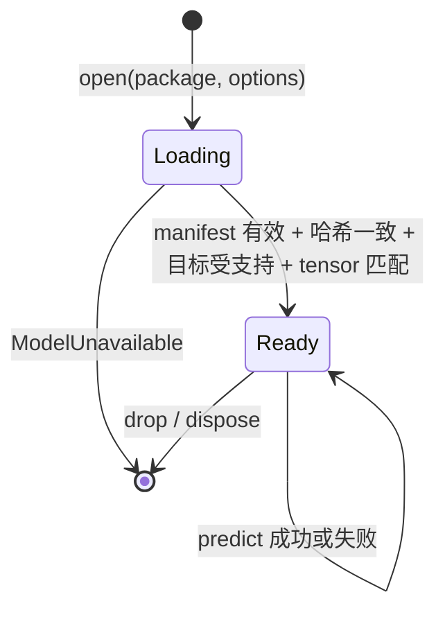

# Data Model: 端侧雷达短临预测运行时

**Date**: 2026-10-24 | **Plan**: [plan.md](plan.md) | **Research**: [research.md](research.md)

逻辑实体与校验规则。Rust 与 TypeScript 签名见 [contracts/rust-api.md](contracts/rust-api.md)、[contracts/web-api.md](contracts/web-api.md)；序列化格式见 `contracts/*.schema.json`。所有时间在核心内为 UTC Unix 秒（`i64`），JSON 边界为带 `Z` 的 RFC 3339。所有二维数组为行主序、`y` 从上到下、`x` 从左到右。

## 1. ModelPackage（模型包）

一个目录：`manifest.json` + `model.onnx` + `reference/`。字段定义见 [model-package.schema.json](contracts/model-package.schema.json)。

| 字段 | 含义 | 规则 |
| --- | --- | --- |
| `schema` | 契约版本 | 必须等于 `preludio.model-package/1`，否则 `ModelUnavailable::UnsupportedSchema` |
| `id` | 可读模型标识，如 `ghost-unet3d-step-22000` | 仅供阅读，不用于判等 |
| `model.file` / `model.sha256` | ONNX 文件与内容哈希 | 加载时计算 SHA-256，不符则 `ModelUnavailable::HashMismatch` |
| `origin` | checkpoint 文件、step 与哈希，源码与配置哈希 | 必填；FR-014 追溯依据 |
| `observation` | 接受的观测：固定 `frames`、`encoding`、`missing_policy`；`cadence_seconds`、`cadence_tolerance_seconds` 与 `grid` 保留为参考元数据 | 见 §2；时间间隔与 manifest 网格 ID/shape 不作为拒绝条件 |
| `tensor_input` / `tensor_output` | ONNX 名称、dtype、shape、轴、值域 | 加载时与 ONNX 会话的实际输入输出比对 |
| `preprocessing` | 有序步骤：可选序列级 `zero_threshold` → `u8_div_255` → `resize_bilinear_aa{h,w}` → `round_f16` | 输入尺寸可变，目标尺寸取自模型 tensor shape |
| `forecast` | `lead_minutes[]`、输出 `encoding`、输出 `grid` | 当前模型的时效列表是训练/reference 元数据；运行时按输出 tensor 帧数与输入平均间隔计算时效 |
| `supported_targets[]` | 已验证的执行组合，每项引用一份验证记录 | 见 §6 |

**当前模型取值**：`frames = 4`，`cadence_seconds = 360`、`cadence_tolerance_seconds = 0`、`grid.id = onix-station-png-732`、`grid.shape = [732, 732]` 和 `lead_minutes = 6..120 步长 6` 是固定训练/reference 元数据，不限制运行时输入或时序。`encoding = training-grayscale-u8` 表示 duckomo-compatible 单通道原始 `u8` 灰度值 `[0,255]`；该标识不定义物理量换算。当前输出 tensor shape 为 `[1, 20, 448, 448]`，输出 `encoding = training-grayscale-normalized`，`grid.georeferenced = false`。

## 2. ObservationSequence（观测序列）

| 字段 | 含义 |
| --- | --- |
| `grid` | `GridDescriptor`：实际输入 `[h, w]`、可选 `id` 与可选 `georeference`；manifest 中的 grid id/shape 不限制接受输入，地理参照不是必需项 |
| `encoding` | 当前模型为 `training-grayscale-u8`：duckomo-compatible 单通道原始 u8 灰度值 `[0,255]` |
| `frames[]` | 固定四帧，从旧到新 |
| `zero_threshold` | 可选序列级 `u8` 阈值；None 时不置零。预处理前仅将严格小于阈值的像素置零；0 无效果。Rust 序列化默认缺省且省略 None |

**ObservationFrame**

| 字段 | 含义 |
| --- | --- |
| `id` | 调用方提供的帧标识（例如 Radiust `FrameRef.logical_id`），原样进入来源记录 |
| `source` | 来源标识，例如 `radiust:rdcap/reflectivity/RCHL` |
| `valid_time` | 观测有效时间（UTC 秒） |
| `values` | 每帧 `U8(h·w)`；所有帧具有相同的正 `h`、`w`。帧像素的灰度含义须符合 duckomo 灰度约定 |
| `quality` | 可选，`h·w` 个 `PixelQuality`；缺省表示调用方声明全部有效 |

**PixelQuality**：`Valid = 0`、`Missing = 1`、`OutsideCoverage = 2`。有效无回波是 `Valid` 且值为零；`Missing` 与 `OutsideCoverage` 均拒绝预测。Radiust `QUALITY_BELOW_DETECTION` 且无前两者可映射为 `Valid` + 零回波值。

### 校验规则（推理前全部检查，违规一次性全部返回）

| 编号 | 规则 | 违规 `InputViolation` |
| --- | --- | --- |
| V-01 | 恰有 `observation.frames` 帧 | `FrameCount { expected, actual }` |
| V-02 | `valid_time` 严格递增（重复视为违规）；不要求等间隔，不按 manifest cadence 拒绝 | `NotIncreasing { index }` |
| V-03 | 输入 `h` 与 `w` 均为正；每帧 values/quality 长度均为 `h·w` | `InvalidShape { name, shape }` / `ShapeOverflow { name }` / `ValueLength { index, expected, actual }` |
| V-04 | `encoding` 等于模型声明的 duckomo-compatible raw u8 grayscale；manifest grid id/shape 与输入不比较 | `EncodingMismatch { expected, actual }` |
| V-05 | 每帧使用 `U8` 且其值/quality 长度为 `h·w` | `UnsupportedValueType { index, expected, actual }` / `ValueLength { index, expected, actual }` |
| V-06 | `missing_policy = reject` 时不得出现 `Missing` 或 `OutsideCoverage` | `UnsupportedQuality { index, missing, outside_coverage }` |


`InputViolation` 的 Rust 变体及字段：

```rust
pub enum InputViolation {
    FrameCount { expected: usize, actual: usize },
    NotIncreasing { index: usize },
    TimeOverflow { index: usize },
    InsufficientFrames { minimum: usize, actual: usize },
    InvalidShape { name: String, shape: Vec<usize> },
    ShapeOverflow { name: String },
    UnsupportedValueType { index: usize, expected: String, actual: String },
    GridMismatch { expected: String, actual: String },
    EncodingMismatch { expected: String, actual: String },
    ValueLength { index: usize, expected: usize, actual: usize },
    NonFinite { index: usize, count: usize },
    OutOfRange { index: usize, count: usize },
    UnsupportedQuality { index: usize, missing: usize, outside_coverage: usize },
}
```

`InsufficientFrames` 用于要求至少两帧时间元数据的 forecast 计算；`TimeOverflow` 表示时间运算无法由 `i64` 表示。`InvalidShape` 和 `ShapeOverflow` 分别报告非正尺寸与尺寸乘法溢出；`UnsupportedValueType` 报告非 u8 输入。`GridMismatch`、`EncodingMismatch` 和 `ValueLength` 携带期望与实际值。`NonFinite` 与 `OutOfRange` 变体保留帧索引和问题值数量；当前 raw-u8 帧路径遇到 F32 时以 `UnsupportedValueType` 拒绝。错误枚举不包含 `Cadence`。
帧数、非递增时间、非正尺寸、不一致帧尺寸、错误编码、长度不符及拒绝的质量标记均在推理前报告。不补帧、不插值、不重网格、不执行物理量转换。输入 georeference 可缺省；不要求与 manifest 地理信息匹配。

## 3. ModelInput（模型输入，内部）

`f32[1, 4, H_t, W_t]`，其中 `H_t` 与 `W_t` 取自模型输入 tensor shape。四帧原始 u8 先应用可选的严格小于 `zero_threshold` 置零，再除以 255 并缩放到 tensor 尺寸；float16 就近舍入步骤按模型预处理契约执行。可变源尺寸不会改变 tensor 输出尺寸。固定 reference 夹具证明其原始输入路径，不证明任意尺寸或非默认阈值的实现结果。

## 4. Forecast（预测结果）

| 字段 | 含义 | 规则 |
| --- | --- | --- |
| `kind` | 固定 `forecast` | 与观测区分 |
| `values` | `f32[leads, h_out, w_out]`，行主序 | 输出校验：shape 匹配、全部有限、在 `tensor_output.range` 内；否则 `InvalidOutput` |
| `encoding` | 输出编码，当前 `training-grayscale-normalized` | 不得标为 dBZ、雨强或概率（FR-008） |
| `grid` | 输出网格，当前 `{id: "onix-station-png-732/448", shape: [448, 448], georeferenced: false}` | 不生成猜测坐标 |
| `lead_minutes[]` | 每帧时效 | 由 `valid_times` 对应的整秒时效除以 60 得到，允许小数 |
| `valid_times[]` | 设输入帧数为 N，平均间隔 `Δ = (last_time - first_time)/(N-1)` 秒；输出第 k 帧（k 从 1 开始）的 lead 为 `round_half_up(k·Δ)` 秒，分别计算每一帧后加到最后观测时间 | 数量为 `tensor_output.shape[1]`；不使用 manifest lead list 计算运行时时效 |
| `provenance` | `ForecastProvenance` | 见下 |

manifest cadence 与 lead list 保留为当前固定模型的训练/reference 元数据。当前实测窗口的四帧间隔为 360 秒、20 个输出，因此仍得到 6、12、…、120 分钟；这项历史样本不构成运行时 cadence 限制。输出网格继续标记 `georeferenced = false`，不附加 CRS 或 affine。

**ForecastProvenance**：`input_frames[]`（`id`、`source`、`valid_time`）、`last_observation_time`、`model`（`id`、`sha256`、`schema`）、`generated_at`（推理完成时刻，独立字段）、`execution`（`ExecutionInfo`）、`preludio_version`。序列化见 [forecast-metadata.schema.json](contracts/forecast-metadata.schema.json)。

**ExecutionInfo**：`target_id`（匹配的 `supported_targets[].id`，验证模式下为 `null`）、`verified`（bool）、`engine`（`onnxruntime` / `onnxruntime-web`）、`engine_version`、`provider`（`cpu` / `wasm`）、`threads`（实际线程数）、`platform`（如 `macos-arm64`、`web-chrome-150`）、`cross_origin_isolated`（仅 Web）。

## 5. 错误分类（FR-009）

| 类别 | 变体 | 上下文 |
| --- | --- | --- |
| `ModelUnavailable` | `FileMissing`、`ManifestInvalid`、`UnsupportedSchema`、`HashMismatch { expected, actual }`、`TensorMismatch`、`TargetNotSupported { platform, supported[] }`、`IsolationRequired`、`EngineLoadFailed` | 路径、期望/实际值 |
| `IncompatibleInput` | `violations: InputViolation[]`（§2） | 每个违规的帧序号与数值 |
| `ExecutionFailed` | 引擎错误 | `ExecutionInfo` + 引擎消息 |
| `InvalidOutput` | `Shape`、`NonFinite { count }`、`OutOfRange { count }` | `ExecutionInfo` |

任何失败都不返回部分预测。

## 6. SupportedTarget、ValidationRecord、MeasurementRecord

**SupportedTarget**（manifest 内）：`id`、`platform`、`engine`、`engine_version`、`provider`、`threads`、`requires_cross_origin_isolation`、`validation`（相对路径）、`measurement`（相对路径）。

**当前登记目标与历史浏览器候选**：

| id | platform | engine / version | provider | threads | 状态 |
| --- | --- | --- | --- | --- | --- |
| `macos-arm64-ort-cpu` | `macos-arm64` | onnxruntime 1.31.0（`ort` 2.0.0-rc.15） | cpu，PreferCPU，memory pattern off | 默认 | 当前登记 |
| `web-chrome-ort-wasm` | `web-chrome` | onnxruntime-web 1.30.0 | wasm，proxy Worker | 4，需跨源隔离 | 历史候选；后续四线程运行未满足性能/响应预算，当前未登记 |

**ValidationRecord**（`reference/validation-<target>.json`）：目标、模型哈希、输入来源（原始帧哈希或张量哈希）、`rtol`/`atol`、最大与平均绝对误差、超差元素数、引擎版本、时间戳。见 [validation-record.schema.json](contracts/validation-record.schema.json)。

**MeasurementRecord**（`reference/measurement-<target>.json`）：设备、系统/浏览器版本、引擎版本、线程、是否隔离、加载 s、冷推理 s、热推理 s 列表（≥ 5 次）、峰值内存 MiB 与测量方法、预算（`warm_max_s = 8`，`memory_max_mib = 1740.8`）、`pass`。同一 schema 文件定义。

## 7. 状态

**Session 生命周期**



**一次 predict**：`Validating → Preprocessing → Running → CheckingOutput → Succeeded`；任一步失败进入 `Failed(错误类别)`。Web 封装把 `idle / running / succeeded / failed` 作为可订阅状态暴露给消费者 UI（FR-012）。

**目标策略**：`SupportedOnly`（默认）只允许 `supported_targets` 中与实际平台、引擎、引擎版本、provider 和线程数完全匹配的组合；同一平台可有多个声明。`Validation` 允许未声明或配置不同的组合运行以产生验证与测量记录；只有完整匹配时 `execution.verified = true` 并返回 `target_id`，否则 `verified = false`、`target_id = null`。
