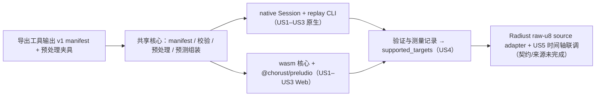

# Implementation Plan: 端侧雷达短临预测运行时（首个运行时里程碑）

**Branch**: `001-local-nowcast-runtime` | **Date**: 2026-10-24 | **Spec**: [spec.md](spec.md)

**Input**: Feature specification from `specs/001-local-nowcast-runtime/spec.md`

## Summary

在现有 `preludio` crate 中实现共享 Rust 核心：模型包加载与 SHA-256 校验、观测序列校验（V-01..V-06）、raw-u8 预处理与可选严格小于阈值置零、输出校验、按四帧平均时间间隔计算有效时间与来源记录。输入为恰好四帧、相同正尺寸、严格递增时间；不要求固定 cadence 或 manifest grid id/shape。输出数量取 `tensor_output.shape[1]`，每个 lead 独立四舍五入至秒（半秒向上），`lead_minutes` 可为小数。原生 macOS 通过 `ort` 2.0.0-rc.15（ONNX Runtime 1.31.0，强制 CPU）执行推理；同一核心编译为 WASM，由 npm 包 `@chorust/preludio` 与 `onnxruntime-web` 1.30.0（WASM，4 线程，Worker 内）组合提供实验性浏览器路径。默认支持策略只运行精确登记的配置；当前模型包只登记 macOS，Chrome 目标因后续浏览器性能/响应验收失败而移除。Radiust US5 需要能提供 duckomo-compatible raw u8 的具体来源；物理转换和地理参照不属于输入契约。

Phase 0 的早期实测（[research.md](research.md)）：macOS 原生热推理 0.97 s、峰值 1,688 MiB；Chrome WASM 4 线程 2.14 s、1,711 MiB；两者与 PyTorch 参考 0 超差。这些 Chrome 数值是历史实验，不代表后续浏览器验收通过。

## Technical Context

**Language/Version**: Rust 1.92（`rust-version` 由 1.70 升级，edition 2021）；TypeScript 5（Web 封装）；Python 3.11（仅 `tools/` 导出与夹具生成）

**Primary Dependencies**: `ort =2.0.0-rc.15`（native，`download-binaries` 静态链接）、`serde`/`serde_json`、`sha2`、`thiserror`、`time`（RFC 3339）、`png`（`cli` 特性）、`wasm-bindgen 0.2.100` + `serde-wasm-bindgen`（wasm32）；Web：`onnxruntime-web 1.30.0`

**Storage**: 文件。模型包目录（manifest + ONNX + reference 记录），不入库；仓库只提交小尺寸夹具

**Testing**: `cargo test`（单元 + 夹具 + 可选全尺寸重放，后者由 `PRELUDIO_MODEL_PACKAGE` 启用）；`bun test`（Web 封装）；浏览器冒烟页 + 验证/测量记录；`python -m unittest`（导出工具）

**Target Platform**: macOS arm64（当前原生支持目标）；Chrome ≥ 150 桌面（WASM，跨源隔离页面）为实验候选，后续四线程浏览器验收未满足热推理与响应预算，当前不声明支持。Safari 暂不支持，等待可比内存测量

**Project Type**: 库（Rust crate + npm 包）+ 开发者重放 CLI

**Performance Goals**: 单次热推理 ≤ 8 s（Phase 0 早期 Chrome WASM 记录 2.14 s；后续 headless Chromium 4 线程运行 21.15–28.60 s，最大 rAF 间隔 1064.54 ms，未达预算）；预处理 < 15 ms/窗口（早期实测原生 3–6 ms，WASM 9–11 ms）

**Constraints**: 峰值内存 ≤ 1740.8 MiB（1.7 GiB）；准备完成后完全断网可运行；不回退云端；不使用 CoreML（部分节点分配导致超差，research R1）；浏览器必须 COOP/COEP；`#![forbid(unsafe_code)]` 保持

**Scale/Scope**: 单模型、单观测序列、单会话复用；当前模型包只登记一个支持目标 `macos-arm64-ort-cpu`，Chrome `web-chrome-ort-wasm` 仍是未通过验收的历史候选；浏览器下载约 59.8 MB（模型 31.1 MB + ORT wasm 28.3 MB + JS 0.4 MB）

## Constitution Check

*GATE: Must pass before Phase 0 research. Re-check after Phase 1 design.*

`.specify/memory/constitution.md` 仍是未填写的模板，没有已批准的原则。以下门槛取自 [docs/spec.md](../../docs/spec.md) 与 [docs/architecture.md](../../docs/architecture.md) 中已确认的项目约束，作为本功能的事实标准。

| 门槛 | 设计前 | 设计后 | 依据 |
| --- | --- | --- | --- |
| G1 本地推理、无云端回退 | Pass | Pass | 两条路径都在设备上执行；Web 只访问 `packageUrl` 与 wasm 资源 |
| G2 只声明已验证组合 | Pass | Pass | `supported_targets` + `TargetPolicy::SupportedOnly` 默认；验证模式结果 `verified = false` |
| G3 可追溯 | Pass | Pass | manifest 记录 checkpoint/源码/配置/模型哈希；每份预测带输入帧、模型哈希、执行信息 |
| G4 公共契约不依赖消费者类型 | Pass | Pass | 不依赖 `radiust-core`；Radiust 侧适配（research R6） |
| G5 不提前抽象 | Pass | Pass | 单 crate；无插件框架；两条执行路径是用户确认的首批范围（D-06） |
| G6 不宣称未验证的物理或地理语义 | Pass | Pass | 当前 contract 限定 duckomo-compatible raw u8；不做物理转换，输出 `georeferenced = false` |

无违规；Complexity Tracking 只记录有意的结构选择。

## Project Structure

### Documentation (this feature)

```text
specs/001-local-nowcast-runtime/
├── plan.md
├── research.md
├── data-model.md
├── quickstart.md
├── contracts/
│   ├── model-package.schema.json
│   ├── forecast-metadata.schema.json
│   ├── validation-record.schema.json
│   ├── rust-api.md
│   └── web-api.md
├── spikes/              # Phase 0 探针源码（证据，不参与构建）
├── checklists/requirements.md
└── tasks.md             # $speckit-tasks 生成
```

### Source Code (repository root)

```text
Cargo.toml               # preludio 0.1.0；rust-version 1.92；crate-type [rlib, cdylib]
                         # features: native(default) → ort；cli → png + bin
src/
├── lib.rs               # 模块与 re-export；#![forbid(unsafe_code)]
├── error.rs             # PreludioError、ModelUnavailable、InputViolation、OutputViolation
├── manifest.rs          # Manifest（serde）、ModelPackage::{open, from_parts}、SHA-256 校验
├── observation.rs       # ObservationSequence、ObservationFrame、FrameValues、PixelQuality、GridDescriptor
├── validate.rs          # V-01..V-06：帧数、严格递增时间、正且同形尺寸、编码与质量
├── preprocess.rs        # 可选 zero_threshold、u8_div_255、抗锯齿双线性、round_f16
├── time.rs              # UTC 秒 ↔ RFC 3339
├── forecast.rs          # 输出校验、按平均输入间隔计算 valid_times、ForecastMetadata、finish_forecast
├── session.rs           # cfg(native)：ort 会话（PreferCPU、memory pattern off）、目标匹配、predict
├── wasm.rs              # cfg(wasm32)：wasm-bindgen 导出核心函数
└── bin/preludio.rs      # cfg(feature = "cli")：replay、记录写出
tests/
├── validate.rs
├── preprocess.rs        # 读取 fixtures/preprocess（PyTorch 生成，逐位比较）
├── forecast.rs          # 有效时间、输出校验、来源
├── replay.rs            # PRELUDIO_MODEL_PACKAGE 存在时：全尺寸一致性、哈希不符、目标策略
└── fixtures/
    ├── preprocess/      # 小尺寸 uint8 帧与 PyTorch 输出（.npy）
    └── invalid/         # 输入帧数/时间/尺寸/编码/质量的失败样本
web/
├── package.json         # @chorust/preludio；构建 wasm 核心并打包 TS
├── src/
│   ├── index.ts         # createSession、类型导出
│   ├── session.ts       # ort-web 会话、proxy、状态、排队
│   ├── core.ts          # wasm 核心加载与调用
│   ├── platform.ts      # web-<browser> 识别、crossOriginIsolated 检查
│   └── errors.ts        # PreludioError
├── test/                # bun test
└── smoke/               # index.html + server.ts（可切换 COOP/COEP），输出验证/测量记录
tools/
├── export_ghost_unet3d.py        # 输出 preludio.model-package/1 manifest 与 reference/
├── make_preprocess_fixtures.py   # 生成 tests/fixtures/preprocess
└── test_export_ghost_unet3d.py
```

**Structure Decision**: 保持单一 Rust crate（`src/`），按目标架构用 cfg 区分 native 推理与 wasm32 导出；Web 包放在 `web/`，只做引擎封装与平台检查，不重复核心逻辑。`tools/` 继续承担导出与参考生成。文档更新：`README.md`（用法与支持目标）、`docs/architecture.md`（当前实现、后端证据表）、`docs/roadmap.md`（M2/M4 证据）。

## Delivery Order



## Risks

| 风险 | 影响 | 处理 |
| --- | --- | --- |
| 原始参考 PNG 不在本机 | 无法重现固定窗口的“原始帧 → tensor”输入（US1 场景 1） | 从来源主机取得并记录原始帧；现有固定 reference 只支持已有样本，不证明任意尺寸或 threshold 行为 |
| PyTorch 夹具版本与训练时版本不同 | 预处理参考可能有末位差异 | 夹具脚本记录 torch 版本；固定原始帧对照 reference input |
| `ort` 为 rc 版本 | API 或二进制变化 | 精确锁定；升级需重跑验证与测量记录 |
| Chrome 四线程浏览器验收未达性能/响应预算 | 热推理 21.15–28.60 s、最大 rAF 间隔 1064.54 ms | 从当前支持声明移除；达标后重新执行完整浏览器和断网验收 |
| Safari 内存未测（RSS 4.8 GiB） | Safari 不能声明支持 | 等待可比内存测量或引擎降低内存用量后再评估 |
| 未设置 PreferCPU 时自动分配 CoreML | 静默超差 | 会话构建强制 PreferCPU；`replay.rs` 检查 `execution.provider = cpu` 且一致性通过 |
| M1 / US5 T054 未完成 | 具体来源兼容性与时间轴联调尚无证据 | 记录具体来源兼容性；不要求物理映射或 georeferencing；完整来源到时间轴集成按 US5/T054 独立验收 |

## Complexity Tracking

| 选择 | 原因 | 未采用的更简单方案 |
| --- | --- | --- |
| 两个推理引擎（`ort` 原生 + `onnxruntime-web`） | 用户确认 macOS 与 Web 同时交付；浏览器无法链接原生 ORT | 只做一个平台——与已确认范围不符 |
| 共享核心编译为 wasm32 | 预处理需与 PyTorch 逐位一致；单一实现只需验证一次（research R3） | TypeScript 重写——两套实现需双重验证且通用缩放库不一致 |
