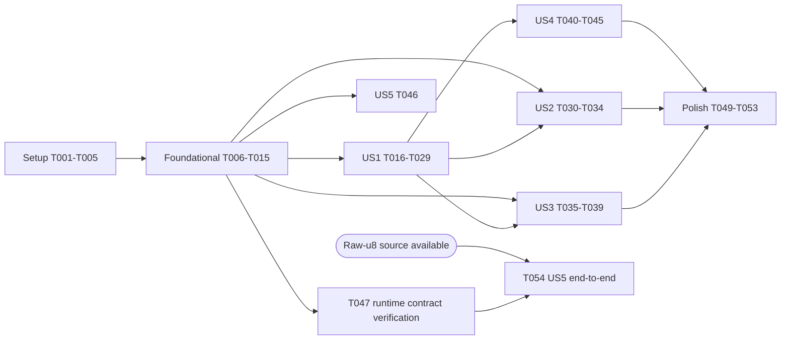

---

description: "Task list for 端侧雷达短临预测运行时（首个运行时里程碑）"
---

# Tasks: 端侧雷达短临预测运行时（首个运行时里程碑）

**Input**: Design documents from `specs/001-local-nowcast-runtime/`

**Prerequisites**: [plan.md](plan.md), [spec.md](spec.md), [research.md](research.md), [data-model.md](data-model.md), [contracts/](contracts/), [quickstart.md](quickstart.md)

**Tests**: 包含。plan.md 的项目结构明确列出 `tests/*.rs`、`web/test/` 与浏览器冒烟页，spec 的验收场景以可重放验证为依据。

**Organization**: 按用户故事分组；每个故事可独立实现与验证。

## Format: `[ID] [P?] [Story] Description`

- **[P]**: 可并行（不同文件、不依赖未完成任务）
- **[Story]**: 所属用户故事（US1…US5）
- 路径均相对仓库根目录 `/Users/blizhan/data/code/github/preludio`

## Path Conventions

- Rust crate：`src/`、`tests/`（单 crate，cfg 区分 native 与 wasm32）
- Web 包：`web/`
- 导出与夹具工具：`tools/`
- 模型包（不入库）：`artifacts/ghost-unet3d-step-22000/`，测试通过环境变量 `PRELUDIO_MODEL_PACKAGE` 指向它

---

## Phase 1: Setup (Shared Infrastructure)

**Purpose**: crate、Web 包与工具的初始化

- [X] T001 Update `Cargo.toml`: `version = "0.1.0"`, `rust-version = "1.92"`, `[lib] crate-type = ["rlib", "cdylib"]`; features `default = ["native"]`, `native = ["dep:ort"]`, `cli = ["native", "dep:png", "dep:nix"]`; dependencies `serde` (derive), `serde_json`, `sha2`, `thiserror`, `time` (`parsing`, `formatting`, `macros`); `[target.'cfg(not(target_arch = "wasm32"))'.dependencies]` `ort = { version = "=2.0.0-rc.15", optional = true }`, `png` (optional), `nix = { features = ["resource"], optional = true }`; `[target.'cfg(target_arch = "wasm32")'.dependencies]` `wasm-bindgen = "=0.2.100"`, `serde-wasm-bindgen`; `[[bin]] name = "preludio" path = "src/bin/preludio.rs" required-features = ["cli"]`; update `description`/`keywords` only if they contradict the plan
- [X] T002 Replace the placeholder in `src/lib.rs` with the module tree from plan.md (`error`, `manifest`, `observation`, `validate`, `preprocess`, `time`, `forecast`, `session` behind `cfg(all(feature = "native", not(target_arch = "wasm32")))`, `wasm` behind `cfg(target_arch = "wasm32")`), keep `#![forbid(unsafe_code)]` and `pub const VERSION`, re-export the public types listed in `contracts/rust-api.md`
- [X] T003 [P] Create `web/package.json` (name `@chorust/preludio`, `type: module`, dependency `onnxruntime-web` pinned `1.30.0`, scripts `build` = `cargo build --release --target wasm32-unknown-unknown --lib` + `wasm-bindgen --target web --out-dir web/pkg` + `bun build`, `test` = `bun test`, `smoke` = `bun smoke/server.ts`) and `web/tsconfig.json` (strict, ES2022, DOM, WebWorker libs)
- [X] T004 [P] Add `/web/node_modules/`, `/web/pkg/`, `/web/dist/` to `.gitignore`
- [X] T005 [P] Create `tools/model_package.py` with `build_manifest(...)` producing a dict that matches `specs/001-local-nowcast-runtime/contracts/model-package.schema.json` (fields and current-model values from data-model.md §1, `supported_targets = []`), and `validate_manifest(path)` that checks it against that schema with `jsonschema`; add `jsonschema` to `tools/requirements-export.txt`

---

## Phase 2: Foundational (Blocking Prerequisites)

**Purpose**: 所有故事共用的契约类型、模型包、校验、时间与预测组装

**⚠️ CRITICAL**: 本阶段完成前不能开始任何用户故事

- [X] T006 Update `src/error.rs` for the active input contract: retain `FrameCount`, `NotIncreasing`, shape/length mismatch, `EncodingMismatch`, and `UnsupportedQuality` violations; remove cadence validation error paths. Preserve model/runtime/output error variants and serde serialization.
- [X] T007 [P] Update `src/observation.rs` and Rust serde contract: add sequence-level `zero_threshold: Option<u8>` with serde default and omission when None; current Ghost observations use raw u8 frames.
- [X] T008 [P] Implement `src/time.rs`: parse RFC 3339 with `Z` or numeric offset to UTC Unix seconds (reject strings without a zone), format UTC seconds as `YYYY-MM-DDTHH:MM:SSZ`
- [X] T009 Implement `src/manifest.rs`: serde `Manifest` mirroring `contracts/model-package.schema.json` (deny unknown fields), `ModelPackage::from_parts(manifest_json, model_bytes)` and native-only `ModelPackage::open(dir)` that reject `schema != "preludio.model-package/1"` (`UnsupportedSchema`), compute SHA-256 with `sha2` and compare to `model.sha256` (`HashMismatch { expected, actual }`), and map missing files to `FileMissing` (depends on T006)
- [X] T010 Update `src/validate.rs` for V-01..V-06: require exactly four frames, strict time increase only, positive same-shape dimensions, raw-u8 encoding and quality/value lengths; ignore manifest cadence and observation grid id/shape for acceptance; reject Missing/OutsideCoverage.
- [X] T011 Update `src/forecast.rs`: validate output count from `tensor_output.shape[1]`; calculate each lead as `round_half_up(k * (last_time - first_time)/3)` seconds for k=1..output_count, independently; set `valid_times` from last observation and `lead_minutes` to lead seconds / 60 as f64. Keep output grid non-georeferenced and use manifest encoding/grid metadata.
- [X] T012 [P] Create `tests/common/mod.rs`: minimal little-endian `.npy` reader/writer for `<f4` and `|u1` C-order arrays, and `model_package() -> Option<PathBuf>` that reads `PRELUDIO_MODEL_PACKAGE` and prints a skip reason when unset
- [X] T013 [P] Create `tools/make_preprocess_fixtures.py` (PyTorch CPU; records torch/torchvision versions in `tests/fixtures/preprocess/meta.json`) generating deterministic uint8 frames and `F.interpolate(x/255, size, mode="bilinear", align_corners=False, antialias=True).half().float()` references for cases sparse levels {0,4,7,11,15,18}, uniform random, all-zero, at shapes `[4,73,61]→[44,37]` and `[1,732,732]→[448,448]`; run it and commit `tests/fixtures/preprocess/*.npy` and `meta.json`
- [X] T014 Update `tools/export_ghost_unet3d.py` to write `manifest.json` via `tools/model_package.build_manifest` and place `input.npy`, `reference.npy`, `forecast.npy`, `validation.json` under `<output>/reference/`; update `tools/test_export_ghost_unet3d.py` assertions for the new layout and schema validity (depends on T005)
- [X] T015 Create `tools/upgrade_model_package.py <dir>` that converts an existing experimental export (old `manifest.json` + root-level `.npy`/`validation.json`) into the v1 layout using `tools/model_package.build_manifest`, then validates it; run it on `artifacts/ghost-unet3d-step-22000/` and confirm `validate_manifest` passes (depends on T005)

**Checkpoint**: 核心类型、模型包加载、校验与预测组装可编译；v1 模型包就绪

---

## Phase 3: User Story 1 - 固定样本本地重放 (Priority: P1) 🎯 MVP

**Goal**: 在 macOS 原生与 Chrome 中用 step 22000 模型和 AZ9002 样本重放，预处理逐位一致、推理与参考一致、断网可运行、哈希不符被拒绝

**Independent Test**: quickstart.md 场景 1、2、4、7：原生 `preludio replay` 与浏览器冒烟页都报告 0 超差；篡改模型字节后得到 `HashMismatch`

### Tests for User Story 1

- [X] T016 [P] [US1] Write `tests/preprocess.rs`: for every case in `tests/fixtures/preprocess/`, `preprocess` output must equal the PyTorch reference bit-for-bit (`f32::to_bits`)
- [X] T017 [P] [US1] Write `tests/replay.rs` (skips without `PRELUDIO_MODEL_PACKAGE`): `predict_tensor` on `reference/input.npy` passes `|a-ref| ≤ 1e-5 + 1e-4·|ref|` against `reference/reference.npy` with `execution.provider = cpu`; if `reference/frames/` exists, `predict` on the four PNGs reproduces `reference/input.npy` exactly and passes parity; a copy of the package with one flipped model byte fails with `HashMismatch`; a manifest with `schema = "preludio.model-package/2"` fails with `UnsupportedSchema`
- [X] T018 [P] [US1] Write `web/test/core.test.ts`: the wasm core's `preprocess` equals `tests/fixtures/preprocess/` references bit-for-bit, and `packageFromParts` with altered model bytes throws `PreludioError` category `ModelUnavailable` / `HashMismatch`

### Implementation for User Story 1

- [X] T019 [P] [US1] Update `src/preprocess.rs`: accept raw u8 `[frames,H,W]` with any positive H/W and apply optional sequence `zero_threshold` (strictly less than, before `/255`) before the existing separable antialiased bilinear resize to tensor spatial shape and binary16 round-to-nearest-even; return `[1,4,H_tensor,W_tensor]`. Existing fixed fixtures cover no threshold only.
- [X] T020 [US1] Update `src/session.rs` and `predict_tensor`: do not reject unequal intervals or compare manifest observation grid id/shape/cadence; enforce exactly four strictly increasing times, use dynamic model tensor shape, then call updated preprocessing and forecast assembly.
- [X] T021 [US1] Update `src/bin/preludio.rs` `replay`: retain package/frames/times/id/source/reference/thread/policy behavior; add `--zero-threshold <u8>` and pass it as sequence `zero_threshold`; do not expose manifest grid id as an input rejection override. Keep stdout/stderr JSON and exit codes 0/2/3/4/5.
- [ ] T022 [US1] Prerequisite (manual): copy `AZ9002_20231130_{092400,093000,093600,094200}Z.png` from the Linux host path recorded in `artifacts/ghost-unet3d-input/provenance.json` into `artifacts/ghost-unet3d-step-22000/reference/frames/` and write `reference/frames.sha256`; until done, US1 raw-frame parity is reported as not run
- [X] T023 [P] [US1] Update `src/wasm.rs` serialization exports so `ObservationSequence.zero_threshold` and current raw-u8 values pass through shared validation/preprocessing; preserve serialized errors and dynamic forecast metadata.
- [X] T024 [P] [US1] Implement `web/src/errors.ts`: `PreludioError` with `category` and `detail` mapped from the wasm core's serialized errors
- [X] T025 [P] [US1] Implement `web/src/platform.ts`: detect `web-chrome` / `web-safari` / `web-firefox` from `navigator.userAgentData` or UA, and report `globalThis.crossOriginIsolated`
- [X] T026 [US1] Implement `web/src/core.ts`: load `web/pkg` wasm once, expose typed wrappers for the T023 exports, convert RFC 3339 `validTime` strings via the core (depends on T023, T024)
- [X] T027 [US1] Implement `web/src/session.ts` `createSession`: fetch `${packageUrl}/manifest.json` and model file (honour `signal`), verify through `packageFromParts`, match `supported_targets` for the detected platform (`TargetNotSupported`), reject when the target requires isolation and `crossOriginIsolated !== true` (`IsolationRequired`), create `ort.InferenceSession` with `executionProviders: ["wasm"]`, `ort.env.wasm.proxy = true`, `numThreads` from target, `wasmPaths` from options; `predict` queues calls, validates and preprocesses via core, creates a fresh `ort.Tensor` per call, runs, then `finishForecast`; `predictTensor(input, frames)` checks frame times only and skips preprocessing, mirroring Rust `predict_tensor`; emits `idle/running/succeeded/failed`; `dispose` releases the session (depends on T025, T026)
- [X] T028 [US1] Implement `web/src/index.ts` exporting `createSession`, `PreludioError` and the types from contracts/web-api.md (depends on T027)
- [X] T029 [US1] Build `web/smoke/server.ts` and `web/smoke/index.html` from `specs/001-local-nowcast-runtime/spikes/browser/`: Bun server serving the package, `web/dist`, `web/pkg` and ORT wasm with COOP/COEP (`--no-isolation` drops them); page calls `createSession`, then `predictTensor` on `reference/input.npy` and `predict` on raw frames when `reference/frames/` exists; 1 cold + 5 warm runs, parity vs `reference/reference.npy`, displays results and an rAF max-gap readout (depends on T028)

**Checkpoint**: quickstart 场景 1、2、4、7 在 macOS 原生与 Chrome 中通过（原始帧部分取决于 T022）

---

## Phase 4: User Story 2 - 不兼容输入在推理前被拒绝 (Priority: P2)

**Goal**: 六类无效序列在推理前以具体原因失败，原生与 Web 一致

**Independent Test**: `cargo test --test validate`、`bun test web/test/validate.test.ts` 与 quickstart 场景 3 全部得到对应 `InputViolation`，且无预测输出

### Tests for User Story 2

- [X] T030 [US2] Copy the v1 manifest produced in T015 to `tests/fixtures/manifest-v1.json` (model hash kept; used by validation tests without the model file)
- [X] T031 [P] [US2] Update `tests/validate.rs`: valid four-frame raw-u8 inputs of arbitrary positive same-frame dimensions pass; unequal strictly increasing times pass; missing frame, repeated/乱序 time, non-positive or mismatched dimensions, incompatible encoding, wrong value/quality length, and Missing/OutsideCoverage fail; manifest cadence and grid id/shape differences do not fail acceptance.
- [X] T032 [P] [US2] Update `web/test/validate.test.ts`: keep zone parsing and frame-count rejection; prove strictly increasing unequal intervals and manifest grid/cadence differences are accepted, while non-positive or inconsistent frame dimensions and rejected quality values fail before `run`.

### Implementation for User Story 2

- [X] T033 [US2] Update the CLI to accept short or misordered sequences for validation, retain `--encoding` override for encoding errors, remove `--grid-id` acceptance testing, and add `--zero-threshold <u8>`; ensure ordered unequal times reach inference.
- [X] T034 [US2] Update `specs/001-local-nowcast-runtime/quickstart.md` §3 with the revised invalid-input cases, an accepted unequal-interval example, threshold usage, and the exact runtime-time calculation.

**Checkpoint**: US1 与 US2 均可独立验证

---

## Phase 5: User Story 3 - 预测可追溯 (Priority: P3)

**Goal**: 每份预测携带正确的有效时间、独立生成时间、输入帧、模型身份与执行信息，并只标为训练灰度编码

**Independent Test**: quickstart 场景 5：最后观测 09:42Z → `valid_times` 09:48Z…11:42Z；输出 JSON 通过 `contracts/forecast-metadata.schema.json`

### Tests for User Story 3

- [X] T035 [P] [US3] Update `tests/forecast.rs`: derive output count from `tensor_output.shape[1]`; compute each lead independently as half-up rounded `k * average_input_interval_seconds`; set `valid_times` from last observation and `lead_minutes` as floating seconds/60; retain fixed-reference endpoint times and validation of output shape/range.
- [X] T036 [P] [US3] Create `tools/test_contracts.py`: validate `tests/fixtures/manifest-v1.json` against the model-package schema and a `preludio replay` stdout sample (`tests/fixtures/forecast-metadata.json`, captured from T021 output) against the forecast-metadata schema
- [X] T037 [P] [US3] Update `web/test/forecast.test.ts` to compare Rust/WASM metadata with dynamic output count, average-interval leads, and floating `lead_minutes` for regular and unequal input intervals.

### Implementation for User Story 3

- [X] T038 [US3] Capture `tests/fixtures/forecast-metadata.json` from a `preludio replay --tensor` run on the v1 package and document the capture command in `tools/test_contracts.py` docstring
- [X] T039 [US3] Show `kind`, `last_observation_time`, `valid_times`, `generated_at`, `model.id`/`sha256` and `execution` on `web/smoke/index.html`

**Checkpoint**: US1–US3 可独立验证

---

## Phase 6: User Story 4 - 目标设备测量与支持声明 (Priority: P4)

**Goal**: 产生验证与测量记录；只有两项记录都通过的组合进入 `supported_targets`；未声明组合与未隔离页面明确失败

**Independent Test**: quickstart 场景 6、7：`measurement-*.json` 中 `pass = true`；`supported_targets` 只含两项首批目标；移除目标后得到 `TargetNotSupported`；`--no-isolation` 得到 `IsolationRequired`；Safari 得到 `TargetNotSupported`

### Tests for User Story 4

- [X] T040 [P] [US4] Extend `tests/replay.rs`: with a manifest whose `supported_targets` lacks the current platform, `Session::open` under `SupportedOnly` fails with `TargetNotSupported`, and under `Validation` succeeds with `execution.verified = false`, `target_id = None`
- [X] T041 [P] [US4] Write `web/test/platform.test.ts`: with stubbed globals, Safari UA → `TargetNotSupported`; Chrome with `crossOriginIsolated = false` → `IsolationRequired`; Chrome isolated → session options use 4 threads

### Implementation for User Story 4

- [X] T042 [US4] Add `--runs <n>` and `--record <dir>` to `src/bin/preludio.rs`: time package load + session creation, cold and warm runs, peak RSS via `nix::sys::resource::getrusage` (`ru_maxrss` bytes on macOS), and write `validation-<target>.json` and `measurement-<target>.json` matching `contracts/validation-record.schema.json` (budget `warm_max_s = 8`, `memory_max_mib = 1740.8`; `pass` computed); in `Validation` policy name files by platform
- [X] T043 [US4] Make `web/smoke/index.html` produce the same two records for the browser target (threads, `crossOriginIsolated`, `measureUserAgentSpecificMemory()` peak, browser version) and offer them as downloads
- [X] T044 [US4] Add `add-target` command to `tools/model_package.py` that appends a `supported_targets` entry only when the referenced validation and measurement records exist, validate against the schema, and both have `pass = true`; extend `tools/test_contracts.py` to cover rejection of a failing record
- [X] T045 [US4] Run quickstart §6 on the M4 Pro (`preludio replay --policy validation --runs 6 --record artifacts/ghost-unet3d-step-22000/reference`) and §7 in Chrome; register `macos-arm64-ort-cpu` and `web-chrome-ort-wasm` with `tools/model_package.py add-target`; record Safari's result as not supported

**Checkpoint**: 支持列表由记录驱动；US1–US4 均已验证

---

## Phase 7: User Story 5 - Radiust 首次完整接入 (Priority: P5)

**Goal**: Radiust 通过适配器提交观测并展示预测；本仓库交付接入契约

**Independent Test**: 接入文档覆盖 `RadarField` → raw-u8 `ObservationSequence` 字段边界；文档不证明实际来源兼容。Quickstart 场景 8 的真实来源端到端验证尚未完成。

- [X] T046 [US5] Update `docs/radiust-integration.md`: document raw-u8 duckomo-gray contract, explicit non-conversion boundary, quality bits (Missing/OutsideCoverage reject; below-detection → Valid zero), arbitrary positive same-shape frames, strictly increasing times without cadence restriction, manifest grid metadata, optional georeference, optional threshold, Rust/Web call patterns, and float lead display.
- [X] T047 [US5] Implement and verify the revised runtime input/forecast contract: accept bytes already supplied as duckomo-compatible single-channel raw u8 gray values (do not implement a physical-value or gray conversion), any positive common frame dimensions resized to model tensor shape, strictly increasing timestamps without cadence enforcement, Missing/OutsideCoverage rejection, valid no-echo zero, optional strict-less-than `zero_threshold`, and output-count/average-interval/half-up-second timing. This task does not require physical mapping or georeferencing evidence; existing fixed artifacts do not prove Duckomo conversion, arbitrary sizes, or non-default threshold behavior.
- [X] T048 [US5] The existing Radiust-side generic F32 adapter and its nowcast adapter tests are present; this does not provide duckomo-compatible raw u8 or establish US5 source compatibility/end-to-end integration.
- [ ] T054 [US5] After a concrete Radiust source supplies duckomo-compatible raw u8 gray bytes, run the real source through local prediction and Radiust timeline integration; verify strictly increasing times, computed forecast times, observation/forecast labels, and failure state. Do not claim geographic alignment or physical-value forecast.

**Checkpoint**: 接入契约文档和通用 adapter/test 已记录；T047 runtime contract 实现与验证已完成。真实模型浏览器 threshold-equivalence 检查和原生固定 tensor 的 10 次禁止联网预测已通过（T056）；标准四线程浏览器性能/响应验收、原始 PNG reference 与完整浏览器断网验收仍未完成。US5 端到端仍不完整，需具体来源能提供 duckomo-compatible raw u8、真实预测时间轴、观测/预测标识与失败状态；不要求物理映射或地图对齐。

---

## Phase 8: Polish & Cross-Cutting Concerns

- [X] T049 [P] Update `README.md`: runtime status, native and web usage snippets, first-batch supported targets, COOP/COEP requirement, link to quickstart
- [X] T050 [P] Update `docs/architecture.md` §2 (current implementation: crate modules, web package, v1 package layout) and §4.2 (manifest v1 replaces the experimental format)
- [X] T051 [P] Update `docs/roadmap.md` M2/M4 status with the recorded measurement files and remaining Safari work
- [X] T052 Verified revised contract with `cargo fmt`; `cargo clippy --all-targets --features cli -- -D warnings`; release wasm32 build with `--no-default-features --features wasm`; `PRELUDIO_MODEL_PACKAGE=artifacts/ghost-unet3d-step-22000 cargo test --features cli` (27 tests); `cargo test --no-default-features` (26 tests); `bun test` in `web/` (9 tests, 57 assertions); `python -m unittest discover -s tools -p 'test_*.py'` (9 tests); and `tsc --noEmit --rootDir .` in `web/`. All listed checks passed.
- [ ] T053 Execute quickstart scenarios 1–7 end to end and fix any drift. Native fixed-tensor offline acceptance passed under a network-denied process sandbox (see T056); retain this task pending because standard four-thread browser performance/responsiveness and original raw-frame reference acceptance have not passed. Historical Chromium failure: one cold and five warm tensor predictions had 0/4,014,080 parity failures (max absolute error 9.406358e-7), 1725.06 MiB memory, 21.15–28.60 s warm runs, and a maximum rAF gap of 1064.54 ms. Raw frames were absent. The timestamp conversion was corrected from milliseconds to seconds. Chrome registration has been removed; its old passing records remain historical evidence only.
- [X] T055 Fix commit-readiness findings: emit Web declaration artifacts; release ORT sessions after canceled initialization; reject raw-u8 Float32Array inputs; bind support registration and runtime verification to measured execution configuration; compare actual native/Web tensor dimensions; validate Web tensor frame times before inference. Share the native ORT environment across session opens. Verification: clippy and formatting passed; 29 native tests with the real package, 26 core-only tests, 14 Python tests in the documented Python 3.11 environment, 12 Web tests (69 assertions), TypeScript checking, release Wasm/Web build, and an independent TypeScript consumer import passed. Real CLI tensor replay had 0/4,014,080 failures (max absolute error 9.536743e-7). Browser evidence and performance limits remain under T053.
- [X] T056 Resolve review contract findings: enforce manifest v1 values and flat grid fields, accept symbolic default threads, reject ONNX metadata shape mismatches during session creation, require exact Web execution target matches, reject incomplete/non-finite reference tensors, compare raw preprocessing only during explicit reference validation, require five warm samples for measurement records, and share NPY header parsing. Verified: formatting, Clippy with warnings denied, 37 native tests with the real package, 28 core-only tests, 16 Web tests (74 assertions), 14 Python tests, TypeScript checking, and release native/Wasm/Web builds. Actual CLI smoke: generated raw-u8 [4,448,448] preprocessing matched its recorded input bit-for-bit; all 4,014,080 outputs matched an independent Python ONNX reference exactly. A 100-element truncated reference exited 5. Actual Chromium default supported-policy initialization rejected this package with TargetNotSupported. Native fixed-tensor replay under `sandbox-exec -p '(version 1)(allow default)(deny network*)'` completed ten predictions, zero parity failures, max absolute error 9.536743e-7, nine warm samples (1.355–1.581 s), and 1651.34 MiB peak RSS; a socket-bind negative control failed with Operation not permitted. Offline validation/measurement evidence is retained in `artifacts/ghost-unet3d-step-22000/reference/{validation,measurement}-macos-arm64-offline.json`, and both records passed their JSON schemas. Generated raw fixtures verify the CLI path only; original PNG replay and real Radiust integration remain unverified.

---

## Dependencies & Execution Order

### Phase Dependencies

- **Setup (Phase 1)**: 无依赖
- **Foundational (Phase 2)**: 依赖 Setup；阻塞所有故事
- **US1 (Phase 3)**: 依赖 Foundational；原始帧一致性另依赖 T022
- **US2 (Phase 4)**: 依赖 Foundational；CLI 任务 T033 依赖 T021
- **US3 (Phase 5)**: 依赖 Foundational；T038/T039 依赖 T021/T029
- **US4 (Phase 6)**: 依赖 US1（会话、CLI、冒烟页）
- **US5 (Phase 7)**: T046 文档和 T048 通用 adapter/test 已完成；T047 依赖 foundational runtime changes；T054 需要 T047 与能提供 raw-u8 duckomo-gray 的具体来源，完成后才可判定 US5 端到端。
- **Polish (Phase 8)**: 依赖所有已交付故事



### Within Each User Story

- 测试先写并确认失败，再实现
- 共享核心（`src/`）先于 CLI 与 Web 封装
- Web：`wasm.rs` → `errors.ts`/`platform.ts` → `core.ts` → `session.ts` → `index.ts` → 冒烟页

### Parallel Opportunities

- Setup：T003、T004、T005 与 T001/T002 并行
- Foundational：T007、T008、T012、T013 并行；T014 与 T015 在 T005 后并行
- US1：T016–T018 测试并行；原生线（T019→T020→T021）与 Web 线（T023/T024/T025→T026→T027→T028→T029）并行
- US2：T030–T032 并行
- US3：T035–T037 并行
- US4：T040、T041 并行；T042 与 T043 并行
- Polish：T049–T051 并行

---

## Parallel Example: User Story 1

```bash
# Tests together:
Task: "Write tests/preprocess.rs bit-exact fixture comparison"
Task: "Write tests/replay.rs parity, hash mismatch, schema checks"
Task: "Write web/test/core.test.ts wasm preprocess + hash mismatch"

# Native and web lines together after src/preprocess.rs lands:
Task: "Implement src/session.rs ort session with PreferCPU"
Task: "Implement src/wasm.rs wasm-bindgen exports"
Task: "Implement web/src/errors.ts and web/src/platform.ts"
```

---

## Implementation Strategy

### MVP First (User Story 1 Only)

1. Phase 1 + Phase 2（含 v1 模型包升级 T015）
2. Phase 3：原生重放（T019–T021）先通过张量入口一致性，再接 Web 线
3. **STOP and VALIDATE**：quickstart 场景 1、2、4、7
4. 拿到原始帧（T022）后补齐原始帧一致性

### Incremental Delivery

1. Setup + Foundational → 契约与模型包就绪
2. US1 → 两平台重放一致（MVP）
3. US2 → 无效输入拒绝
4. US3 → 来源与有效时间验收
5. US4 → 记录驱动的支持声明
6. US5 → 接入契约；M1 后端到端

---

## Notes

- [P] = 不同文件且无未完成依赖
- 模型包与原始帧不入库；依赖它们的测试在缺失时打印跳过原因
- 任何 `ort`、`onnxruntime-web`、PyTorch 参考或预处理变化都需重跑 T045 并更新记录
